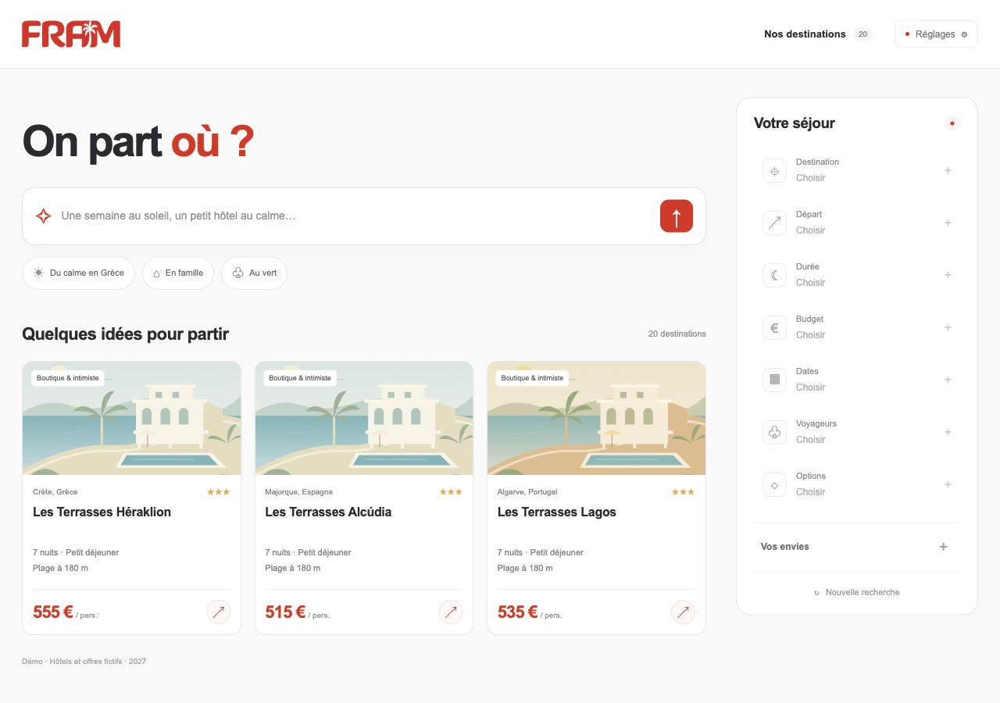

# FRAM — Recherche de séjours

Une application web de recherche conversationnelle de séjours, en français. Décrivez vos envies dans un champ de recherche ; l’agent Mistral construit les critères à droite et propose des hôtels à partir d’un catalogue de démonstration.

**Démo en ligne : [ouvrir FRAM](http://51.15.129.189/).** Les fichiers et les consignes d’exploitation du serveur sont décrits dans [deploy/README.md](deploy/README.md).

**300 hôtels fictifs, 20 destinations, 1 200 offres simulées.** Aucune réservation, aucun stock réel, aucun prix de marché. Les illustrations sont locales et ne représentent pas les hôtels.



## Démarrer en deux minutes

Prérequis : **Node.js 22 ou plus récent**, une clé API Mistral avec accès aux modèles de conversation et d’embeddings, et une connexion Internet pour les appels Mistral.

```sh
git clone <URL_DU_DEPOT>
cd <DOSSIER_DU_DEPOT>
cp .env.example .env
```

Ouvrez `.env` et renseignez votre clé :

```dotenv
MISTRAL_API_KEY=votre_cle_mistral
```

Puis lancez :

```sh
npm start
```

Ouvrez **http://127.0.0.1:3000**. Aucune dépendance à installer, aucun service de base de données à configurer. Sous Windows, remplacez `cp` par `Copy-Item` dans PowerShell. Arrêtez le serveur avec `Ctrl+C`.

Sans clé, le catalogue et les fiches restent consultables. La conversation nécessite une clé valide. La première recherche sémantique indexe les 300 fiches ; sa progression est visible. Les recherches suivantes réutilisent ce cache. Les appels à l’API utilisent les crédits et les limites de votre compte Mistral.

## Essayer la conversation

Commencez par :

> Une semaine en Grèce, au départ de Lyon, 1 000 € maximum par personne.

Puis ajoutez :

> Un petit hôtel calme près d’une plage de sable, loin des grands complexes.

Et corrigez :

> Finalement le Portugal, avec un budget de 850 € par personne. Je garde les mêmes envies.

Les critères se mettent à jour après chaque message, avant la fin de la recherche. Les nouvelles précisions conservent le contexte ; les corrections remplacent les choix précédents. Seul le dernier message est affiché ; le bouton **Étendre la conversation** permet de revoir l’historique. La recherche n’est pas déclenchée à chaque frappe : envoyez avec Entrée ou le bouton flèche. Maj+Entrée permet un retour à la ligne.

Cliquez directement sur **Destination**, **Départ**, **Durée**, **Budget**, **Dates**, **Voyageurs** ou **Options** dans le panneau de droite pour utiliser un formulaire. Les valeurs choisies sont validées et appliquées sans passer par l’extraction du modèle, puis la sélection est recalculée. Les autres critères et envies restent conservés. Le choix est ajouté à l’historique et reste compris lors des messages suivants. Les envies sont également modifiables avec le bouton **+**.

Autre scénario :

> Nous sommes 2 adultes et 2 enfants. Une semaine à Djerba au départ de Marseille, en tout compris. Budget total : 3 500 euros. Départ le 10 août 2027.

Ouvrez **« Pourquoi ce séjour ? »** pour voir les passages sources et la flèche d’une carte pour consulter la fiche complète. **Nouvelle recherche** efface la conversation courante. L’historique est conservé en mémoire dans l’onglet, pas sur le serveur ni après un rechargement. L’objet `search_holidays` est consultable dans **Réglages → Données de recherche**.

## Comment fonctionne la recherche

1. **Compréhension avec Mistral.** L’historique est transformé en JSON contraint par un schéma. Les filtres stricts doivent être associés à des citations exactes des messages utilisateur. Les champs non modifiés sont conservés à partir du contexte validé du tour précédent. Le serveur contrôle les types, dates, bornes et quelques confusions fréquentes : « petit hôtel » ne signifie pas « petit déjeuner », un pays ne sélectionne pas toutes ses îles et un budget ambigu ne devient pas automatiquement un budget par personne. Les libellés d’envies doivent être des extraits des mots du client ; leur concaténation produit la requête sémantique, pour éviter l’ajout de goûts par défaut.
2. **Filtres exacts.** Pays, destination, aéroport, durée, budget, période de départ, voyageurs, pension, catégorie minimale, établissement réservé aux adultes et types exclus éliminent les offres incompatibles. Les disponibilités et prix consultés sont ceux des offres synthétiques. Aucun filtre n’est élargi silencieusement.
3. **Embeddings réels.** `mistral-embed` vectorise les descriptions, puis la synthèse des envies. Une similarité cosinus classe les candidats déjà filtrés. Pour 300 fiches, une recherche exhaustive en mémoire est simple et suffisante ; pas de service vectoriel externe.
4. **Comparaison et RAG.** Mistral compare les 18 premiers candidats pour tenir compte des nuances et négations, puis sélectionne jusqu’à six hôtels et des identifiants de passages pertinents. Le serveur recopie exclusivement le texte original des passages : le modèle ne rédige pas de caractéristiques d’hôtel. Les goûts servent au classement, pas à garantir une correspondance parfaite ; les écarts restent visibles dans les fiches.
5. **Réponse progressive.** Le serveur diffuse des événements NDJSON : progression, critères, résultats, réponse. Le panneau droit se met à jour dès l’extraction terminée.

Quand aucun goût n’est précisé, les exemples sont classés par prix, sans appel aux embeddings. Quand aucun hôtel ne passe les filtres, les contraintes sont conservées et l’application propose de les préciser.

Les embeddings sont stockés dans `.cache/embeddings.json` et exclus de Git. Chaque entrée est identifiée par le modèle et le hash du texte de l’hôtel : changer une fiche réindexe seulement cette fiche ; changer le modèle déclenche la reconstruction correspondante. Les lots terminés sont sauvegardés pour reprendre après une interruption.

La normalisation des envies et la sélection sémantique restent probabilistes. Les filtres appliqués sont vérifiables via l’objet `search_holidays`, les offres et les extraits ; l’application ne prétend pas comprendre parfaitement toutes les formulations.

## Le catalogue et sa génération

Le générateur croise **20 destinations × 5 profils × 3 variantes**. Les profils définissent une ambiance cohérente, des équipements, une taille, une pension et un public. Les variantes font varier les étoiles, les distances, les prix et parfois le type de plage. Les descriptions contiennent aussi des contre-exemples explicites : un club animé, des galets au lieu du sable, un hôtel éloigné de la mer. Ils permettent de tester les exclusions et les nuances.

| Pays | Destinations |
| --- | --- |
| Grèce | Crète, Rhodes, Corfou, Kos, Cyclades |
| Espagne | Majorque, Tenerife, Costa del Sol |
| Portugal | Algarve, Madère |
| Maroc | Marrakech, Agadir |
| Tunisie | Djerba |
| Turquie | Antalya, Bodrum |
| Italie | Sicile, Sardaigne |
| Chypre | Chypre |
| Croatie | Dubrovnik |
| Maurice | Île Maurice |

Les cinq profils : **boutique intimiste**, **famille**, **club animé**, **nature et randonnée**, **spa réservé aux adultes**. Le catalogue est accessible dans l’interface avec des filtres par destination et profil.

Chaque fiche de `data/hotels.json` contient : identifiant, nom fictif, pays, destination, ville, profil, étoiles simulées, nombre de chambres, public, ambiance, situation, équipements, type et distance de plage. Ses quatre offres précisent : 5/7/10/14 nuits, aéroports possibles, pension, prix adulte/enfant en euros, capacité, validité, prestations et disponibilité simulée.

**Hypothèses des offres :**

- Validité du **1er janvier au 31 décembre 2027** ; le séjour complet doit entrer dans cette période. Les dates sont des jours possibles de départ simulés, sans horaire de vol.
- Prix par adulte pour le séjour, vols et transferts simulés inclus. Tarif enfant fixé à 65 % du prix adulte, arrondi à l’euro ; aucun moteur tarifaire ni distinction d’âge.
- Maximum de six voyageurs par offre, deux pour le profil spa. Pas de répartition réelle des chambres.
- Sans composition de groupe, la carte donne un prix adulte et la fiche une occupation **indicative de deux adultes**. Un budget total n’est appliqué qu’avec le nombre d’adultes et d’enfants connu.
- CDG, ORY, LYS et MRS sont présents pour chaque hôtel. NTE, TLS, BOD, LIL, NCE, BRU et GVA sont distribués entre les fiches. Ce sont des possibilités fictives, pas des lignes aériennes réelles.
- Les étoiles sont une catégorie de démonstration. Aucune promesse d’une classification officielle, d’une certification ou d’un équipement réel.

Pour modifier ou agrandir le catalogue, éditez `scripts/generate-catalogue.js`, puis :

```sh
npm run catalogue
```

La génération est déterministe et ne nécessite pas de clé. Pour préindexer les fiches plutôt que d’attendre la première recherche :

```sh
npm run index
```

Redémarrez le serveur après modification du catalogue ou de `.env`. Pour régénérer les illustrations SVG locales : `npm run artwork`.

## Configuration

| Variable | Valeur par défaut | Utilisation |
| --- | --- | --- |
| `MISTRAL_API_KEY` | vide | Clé propre à la personne qui lance le projet |
| `MISTRAL_CHAT_MODEL` | `mistral-small-latest` | Extraction et comparaison des fiches ; doit accepter les sorties JSON structurées |
| `MISTRAL_EMBED_MODEL` | `mistral-embed` | Même modèle pour les fiches et les requêtes |
| `PORT` | `3000` | Port HTTP local |
| `HOST` | `127.0.0.1` | Écoute locale par défaut |

La clé reste côté serveur, n’est pas envoyée au navigateur et n’est pas retournée par les API de l’application. `.env` est ignoré par Git et exclu du contexte Docker. Ne mettez pas de vraie clé dans `.env.example`. L’historique de conversation, les critères sémantiques et les fiches nécessaires sont transmis à Mistral pour exécuter la recherche. Les erreurs fournisseur brutes ne sont pas exposées dans l’interface.

L’application est conçue pour un lancement local avec la clé de chaque utilisateur. Elle ne comporte pas d’authentification pour une exposition publique. Le démarrage par défaut et les ports Docker sont limités à la machine locale.

## Docker (facultatif)

Avec `.env` renseigné et Docker installé :

```sh
docker compose up --build
```

Ouvrez la même adresse locale. Un volume nommé conserve les embeddings entre deux démarrages. Pour arrêter : `docker compose down`. Le lancement Node.js est suffisant et constitue le chemin le plus direct.

Le parcours Node.js a été testé localement et l’image Docker a été construite et vérifiée sur le serveur. Le déploiement derrière Nginx utilise la configuration de production dans `deploy/`.

## Vérification

```sh
npm test
```

Les tests ne font aucun appel Mistral. Ils couvrent les filtres et dates, les budgets familiaux, les exclusions, la provenance des critères, les extraits exacts, le cache et sa reprise, le format REST et le flux HTTP. La suite HTTP ouvre un port local temporaire.

Avec le serveur démarré et une clé valide, un test réel, qui utilise le quota API, est également fourni :

```sh
npm run test:live
```

Il vérifie la demande Grèce/Lyon/budget, le classement d’une plage de sable, un changement vers le Portugal, un budget impossible et une demande familiale datée. C’est un test d’intégration de comportement probabiliste : une modification du modèle Mistral peut faire évoluer son résultat.

## Structure

```text
public/               Interface HTML, CSS et JavaScript, illustrations SVG
server/index.js       Serveur HTTP natif Node.js, routes, flux NDJSON
server/agent.js       Extraction, filtres, recherche et sélection des passages
server/grounding.js   Contrôle des citations justifiant les critères exacts
server/edits.js       Validation et application des formulaires sans extraction IA
public/criteria-edit.js Libellés partagés des changements de critères
server/schema.js      Schémas et validation locale
server/catalogue.js   Lecture du catalogue, filtres d’offres, similarité cosinus
server/mistral.js     Appels REST, délais, erreurs et reprises bornées
server/embeddings.js  Index vectoriel local et cache persistant
scripts/              Génération, préindexation et test réel
data/hotels.json      Catalogue reproductible, lisible et modifiable
test/                 Tests sans clé ni appel réseau externe
```

Documentation des API utilisées : [sorties structurées Mistral](https://docs.mistral.ai/inference/conversations/structured-output/custom), [embeddings Mistral](https://docs.mistral.ai/api/endpoint/embeddings).

L’interface reprend le rouge FRAM `#e22518` relevé sur le [site officiel](https://www.fram.fr/) ; le logo FRAM provient de ce site et est conservé localement. Cette application reste un prototype avec des données fictives.
